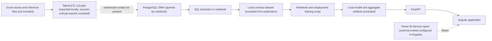

# Microcredit BI & Data Platform

An internship project exploring microcredit portfolio data through a local machine-learning API and an Angular web application. It also contains a notebook that queries a PostgreSQL data warehouse. This repository documents the verified software components and identifies ETL, warehouse, and Power BI artifacts that are not included here.

> **Data protection:** this repository intentionally excludes contract-level data, trained model files, local credentials, and the original notebook. The API requires approved local copies of its model and aggregate files before its prediction endpoints can operate.

## Project overview

The application presents historical credit amount estimates, declared-employment classes, descriptive contract segments, and a monthly contract forecast. It is an analysis aid, not a credit approval, repayment-capacity, profitability, or default-risk system.

## Business problem

Explore historical microcredit contracts and make portfolio patterns accessible through BI and ML interfaces. Available data records contract characteristics and declared employment; it does not provide verified post-financing job outcomes or a repayment history suitable for learning default risk.

## Verified architecture

Dashed links represent dependencies whose DWH DDL and Power BI project are not included. Talend job inventory is documented, but local job files and source data are excluded, so the ETL is not reproducible from this repository.

## Implemented in this folder

- FastAPI application with health and metadata routes, amount estimation, declared-employment classification, descriptive segmentation, and forecast-data routes.
- Python ML utilities to load local artifacts and prepare request features.
- Angular 21 single-page application with home, predictions, forecasts, method, and dashboard pages.
- Power BI Service embed configuration in the Angular dashboard page; the report itself is hosted externally.
- ML notebook and employment-model training code exist locally. A sanitized notebook copy is provided under notebooks/.

## Partial or external components

- **Talend ETL:** 13 local Talend jobs were inspected read-only. Their inventory and observed component types are summarized in [docs/etl.md](docs/etl.md); raw jobs and source data are excluded for security and privacy.
- **PostgreSQL DWH:** the notebook contains a query against fact_contract and related dimensions. DDL, initialization scripts, credentials, and a portable DWH backup are absent.
- **Power BI:** Angular is configured to embed a Power BI Service report. A PBIX/PBIP project and screenshot exports are absent.
- **ML runtime artifacts:** the API loads local model and aggregate files. They are excluded because they were derived from company contract data. A public clone needs authorized local artifacts before ML endpoints can work.
- **Forecast:** the API serves history and forecast values from CSV files; it does not calculate a new forecast per request.

## Data and methods

The local training extract contains 13,632 contract rows and beneficiary/contract attributes, including geographic, financial, and employment fields. It is confidential and excluded. The notebook reports the observed contract period as 2017-07-04 through 2023-05-11.

- **Amount:** historical contract amount estimates, with and without annual rate. The notebook reports cross-validation MAE values of 1,944 TND (with rate) and 2,969 TND (without rate). These are average validation errors, not guarantees for an individual case.
- **Declared employment:** classification into 0, 1, or 2+ declared new jobs. The target is a contract declaration, not verified jobs created.
- **Segmentation:** four descriptive K-means profiles. The groups are exploratory profiles, not success, risk, or profitability scores.
- **Monthly forecast:** a three-month forecast served from local CSV output. The API labels it indicative and reports an approximate relative error of 38%.

No repayment-event history is present in the available extract; a missed-payment/default-risk model is not implemented.

## API routes

| Method | Route | Purpose |
|---|---|---|
| GET | /health | API/model availability status |
| GET | /meta | Accepted activities, governorates, dates, and employment evaluation metadata |
| POST | /predict/montant | Historical amount estimate, optionally using annual rate |
| POST | /predict/emplois | Declared-employment class, class probabilities, and comparable-contract aggregates |
| POST | /segment | Descriptive segment and profile |
| GET | /prevision | Historical monthly counts and stored forecast values |

Interactive API documentation is available at /docs when the local API is running.

## Technologies verified

Python, FastAPI, Pydantic, pandas, NumPy, scikit-learn, joblib, PostgreSQL access through SQLAlchemy in the notebook, Angular, TypeScript, Chart.js, pnpm, and a Power BI Service iframe configuration. Talend Open Studio 8.0.1 jobs were inspected in the local workspace; their raw files are not present here.

Docker, Airflow, MLflow, and Flask are not present in the inspected project.

## Repository structure

    api/                  FastAPI routes and ML feature/model helpers
    data/README.md        Required local data files; no data is published
    docs/                 Architecture, DWH, ETL, BI, ML, API, web, security notes
    frontend/             Angular application
    models/README.md      Local model artifact requirements
    notebooks/            Sanitized notebook copy without outputs or secrets
    requirements.txt      Python API dependencies
    test_api.py           Local API checks (requires local data/model artifacts)

## Run locally

Use Python 3.12 with the compatible scikit-learn version in requirements.txt, plus Node.js and pnpm compatible with the Angular project.

1. Create a Python environment and install dependencies:

       python -m venv .venv
       .venv\Scripts\python.exe -m pip install -r requirements.txt

   To execute the PostgreSQL notebook, also install its optional packages with `python -m pip install -r requirements-notebook.txt`.

2. Put authorized local artifacts in models/ and data/ as listed in data/README.md and models/README.md. Do not commit them.
3. In terminal 1, launch FastAPI:

       .venv\Scripts\python.exe -m uvicorn api.main:app --reload --port 8000

4. Install and start Angular from terminal 2:

       cd frontend
       pnpm install --frozen-lockfile
       pnpm start

5. Open http://localhost:4200. Swagger is at http://localhost:8000/docs.

The development proxy in frontend/proxy.conf.json forwards API routes to port 8000. Running only one server is not enough for the complete application.

## Checks

With authorized local data/model files installed:

       .venv\Scripts\python.exe test_api.py
       cd frontend
       pnpm build

The API check exercises health, metadata, amount, employment, comparable contracts, segmentation, and date validation. The frontend production build does not require private model files.

## Limitations and future improvements

- Keep original Excel files, DWH exports, contract extracts, and fitted models outside public Git.
- Add sanitized Talend job exports and DWH DDL only after confirming redistribution rights and removing credentials and personal data.
- Add sanitized screenshots of the actual Power BI report and web pages.
- Add automated API tests using an isolated synthetic fixture.
- Restrict CORS and add authentication, logging, and deployment configuration before public production use.
- Collect verified repayment and post-financing outcome data before designing default-risk or real employment-impact models.

## Screenshots

No approved screenshot files were present in the inspected project. No synthetic or misleading screenshots have been added.

## License

No open-source license is included. This is an internship project that depends on company data and external report configuration; the owner/company should decide licensing and redistribution rights before choosing a license.

