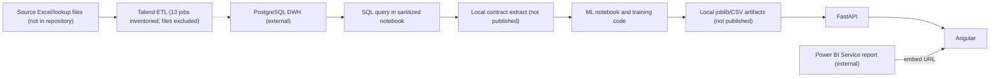

# Architecture and implementation status

The repository contains the ML-facing portion of the internship application: the notebook shows a SQL extraction from PostgreSQL, api/ serves predictions and aggregate forecast data, and frontend/ is an Angular client using an API proxy. The dashboard component contains a Power BI Service embed URL.

Thirteen Talend jobs were inspected read-only in the local workspace; their files are not included in this checkout. The Power BI report source project, source Excel files, and data-bearing DWH export are not included. Sanitized schema-only SQL and aggregate screenshots are included.

## Status

| Component | Status | Evidence / boundary |
|---|---|---|
| PostgreSQL query/extract logic | Partially implemented | SQL query in notebook; schema-only DDL and safe aggregate query examples under sql/; no portable credentials or data rows |
| Talend ETL | Local workspace inspected | 13 job names and component types inventoried; raw Talend files, source data, and run logs are not included |
| ML training and feature preparation | Partially implemented | Notebook and employment training script exist; inputs/artifacts are local and excluded |
| FastAPI inference API | Implemented locally | Routes in api/main.py; local API check passes with local artifacts |
| Angular application | Implemented locally | Routes, pages, API service, and build configuration are present |
| Power BI report integration | Partially implemented | External report iframe configured; four captured report pages documented; PBIX/PBIP and refresh configuration absent |
| Deployment/authentication | Planned | No production deployment setup or API authentication found |

No component is described as production-ready.

The API expects local files under data/ and models/. See their README files. Angular proxies /health, /meta, /prevision, /segment, and /predict/* to 127.0.0.1:8000.

