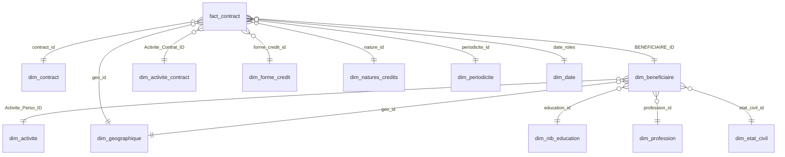
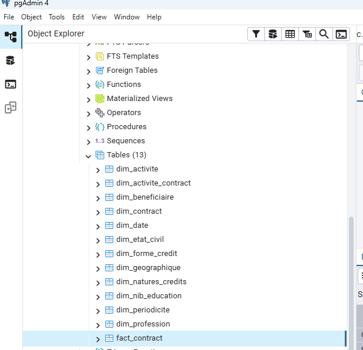
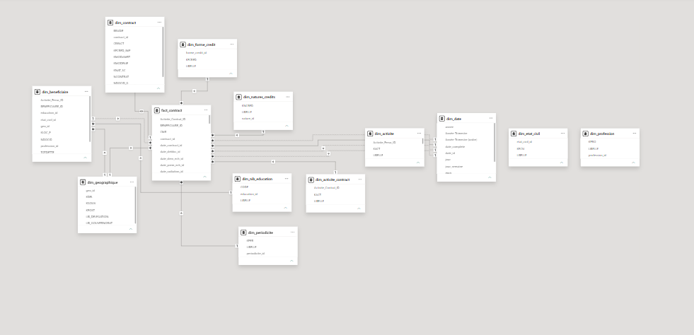

# PostgreSQL data warehouse

## Evidence available here

The sanitized ML notebook contains a SELECT from public.fact_contract and joins to dimensions for contract, beneficiary, education, profession, civil status, personal activity, contract activity, credit form, credit nature, payment periodicity, geography, and date roles. It derives a training extract with contract and beneficiary attributes.

The notebook output recorded 13,632 rows and unique contract IDs. A schema-only extract based on the local PostgreSQL export is published in [`sql/schema.sql`](../sql/schema.sql); it contains table definitions and key constraints only. The local derived extract and original data-bearing export are intentionally not included.

The exported schema contains 13 tables: one fact table (`fact_contract`) and 12 dimensions. A compact relationship model is shown below; it summarizes the join paths used by the notebook and semantic model, not declared foreign-key constraints.

The fact table stores contract-level measures such as initial amount, installment, rates/fees, installment count, grace months, and employment declarations. Date keys cover contract, disbursement, first/last installment, and radiation. See [`docs/powerbi.md`](powerbi.md) for how the report uses these fields and its KPI limits.

The following two Desktop captures show the table list and a relationship view available during project work. They are visual references; the DDL in `sql/schema.sql` remains the precise source for exported column and constraint definitions.

| PostgreSQL table list | DWH relationship view |
|---|---|
|  |  |

## Join paths shown in the notebook

The SQL uses joins from fact_contract.contract_id to dim_contract.contract_id and fact_contract.BENEFICIAIRE_ID to dim_beneficiaire.BENEFICIAIRE_ID; beneficiary keys to education, profession, civil-status, and personal-activity dimensions; and fact keys to contract-activity, credit-form, credit-nature, periodicity, geography, and date dimensions. Separate date roles are used for contract, disbursement, and radiation dates.

These are query join expressions, not proof that database constraints are declared.

## Talend evidence and remaining gaps

The local Talend Open Studio workspace was inspected read-only and contains 13 jobs for contract/beneficiary loading, reference dimensions, and `fact_contract`. See [etl.md](etl.md) for the inventory and components observed. The workspace confirms that Talend jobs exist, but it does not by itself prove successful execution or establish database constraints.

The schema-only export does not include foreign-key declarations. Exact refresh strategy, source-to-target field mappings, and business definitions still need validation against the company flow guide and Talend job configuration. Do not publish a real DWH backup or beneficiary-level data.

