# ETL Talend

## Workspace inspecté

L’inventaire a été vérifié en lecture seule dans le workspace Talend Open Studio 8.0.1 `STAGEPROJECT`. Il contient 13 jobs (fichiers `.item`) sous `process/SA` :

- Référentiels / dimensions : `DIM_ACTIVITE_CONTRAT`, `DIM_BENEFICIAIRE`, `dim_contract`, `DIM_CONTRAT`, `DIM_ETAT_CIVIL`, `DIM_FORME_CREDIT`, `DIM_GEOGRAPHIE`, `DIM_LISTE_ACTIVITE_PERSONNE`, `DIM_NATURES_CREDITS`, `DIM_NIV_EDUCATION_PP`, `DIM_PERIODICITE`, `DIM_PROFESSION`.
- Table de faits : `fact_contract`.

Les jobs d’alimentation des référentiels utilisent surtout `tFileInputDelimited`, `tMap` et `tPostgresqlOutput`. Les jobs de contrat et de bénéficiaire utilisent `tFileInputExcel`, des transformations `tMap` et des sorties PostgreSQL; ceux-ci comprennent aussi des opérations de dédoublonnage (`tUniqRow`). Le job bénéficiaire contient en plus un tri et des lectures PostgreSQL; le job de faits contient des lectures PostgreSQL et plusieurs flux de dimension.

Cet inventaire confirme la présence et les composants déclarés dans les jobs, mais il ne prouve pas leur exécution réussie ni l’ordre d’exécution. Aucun journal d’exécution ni export de contexte exploitable n’a été vérifié. Le workspace n’a pas été modifié.

## Limites de reproductibilité

Les sources Excel/CSV, paramètres locaux, schéma SQL et journaux de traitement ne sont pas inclus dans le dépôt public. Les noms des jobs et composants décrivent l’architecture générale, mais les mappings champ par champ, règles de qualité, stratégies de chargement et dépendances exactes doivent être confirmés dans Talend Studio et PostgreSQL.

Les fichiers `.item` bruts ne sont pas publiés : le fichier `talend.project` du workspace contient des champs d’authentification. Ne jamais publier ce workspace, les contextes locaux, les classeurs d’origine ou des exports au niveau bénéficiaire. Toute extraction Talend future doit être expurgée et contrôlée avant ajout au dépôt.

Le notebook public montre une extraction SQL aval de `fact_contract` et des dimensions pour construire le jeu de modélisation. Il ne remplace pas les jobs Talend.

## Captures de jobs disponibles

Les captures ci-dessous proviennent du dossier de démonstration Desktop du 14 octobre 2026. Elles montrent des composants et des noms de flux, jamais les lignes du fichier source. Deux images documentent le job `DIM_ACTIVITE_CONTRAT` : son design et une vue avec statistiques d’exécution visibles. Ces exemples ne constituent pas des journaux complets ni une preuve que les 13 jobs ont tous été exécutés avec succès.

| Job / table cible | Capture |
|---|---|
| `DIM_ACTIVITE_CONTRAT` — design | 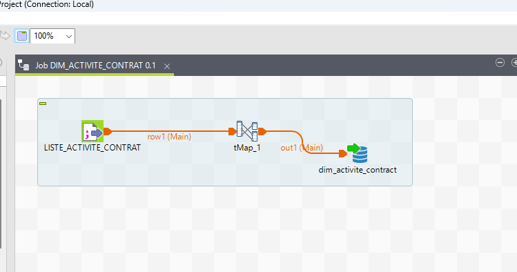 |
| `DIM_ACTIVITE_CONTRAT` — vue d’exécution | 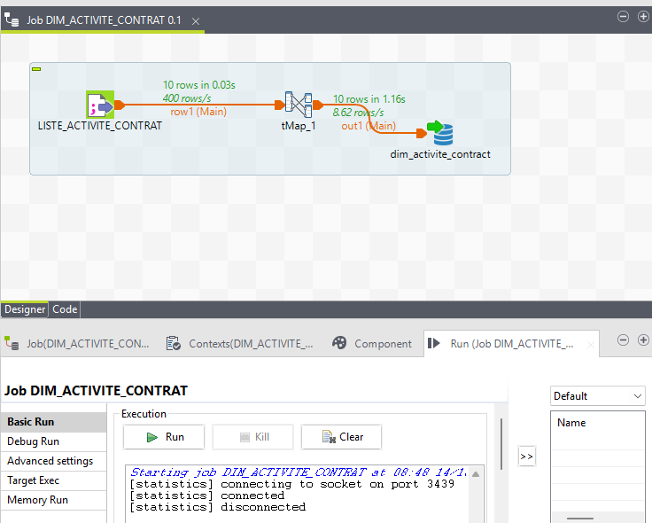 |
| `DIM_BENEFICIAIRE` et dimensions de référence | 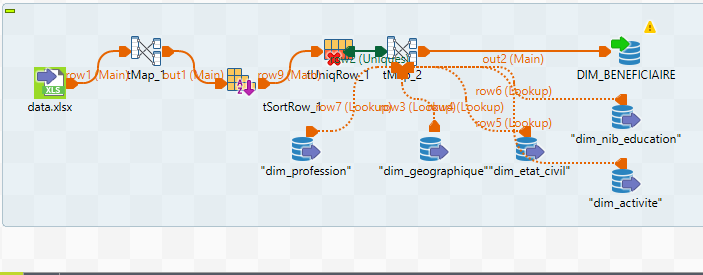 |
| `dim_contract` | 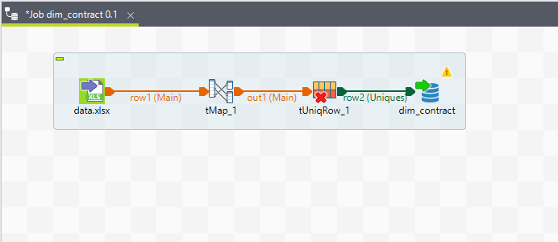 |
| `DIM_ETAT_CIVIL` | 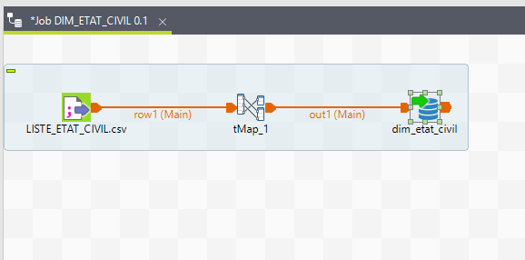 |
| `DIM_FORME_CREDIT` | 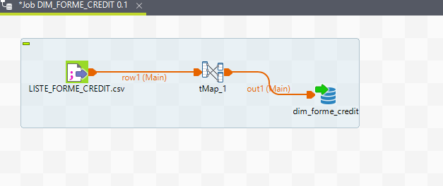 |
| `DIM_GEOGRAPHIE` | 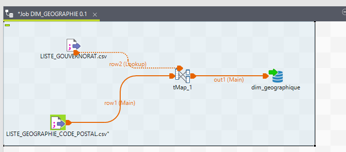 |
| `DIM_NATURES_CREDITS` | 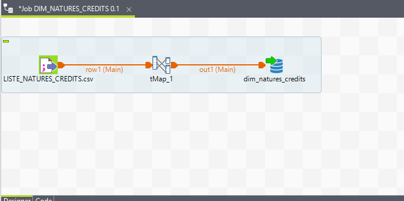 |
| `DIM_PERIODICITE` | 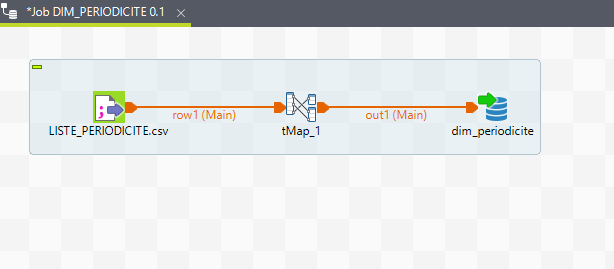 |
| `DIM_PROFESSION` | 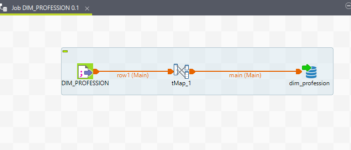 |
| `fact_contract` | 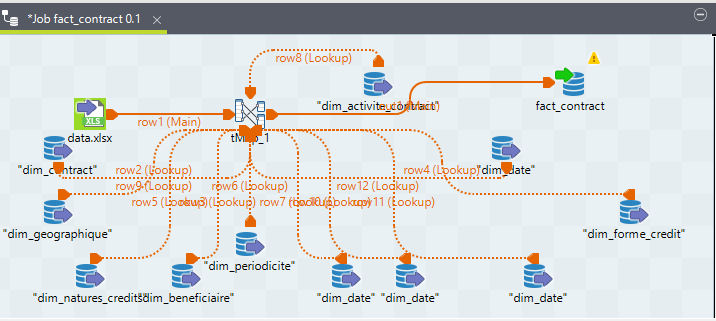 |
| `DIM_LISTE_ACTIVITE_PERSONNE` | 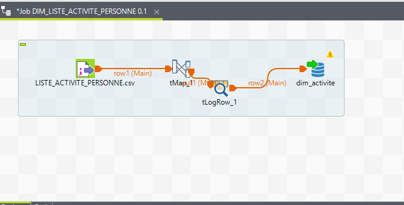 |
| `DIM_NIV_EDUCATION_PP` | 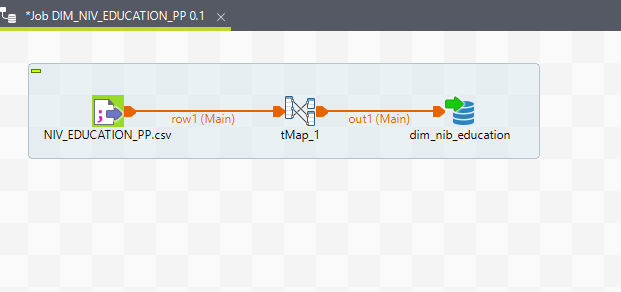 |

