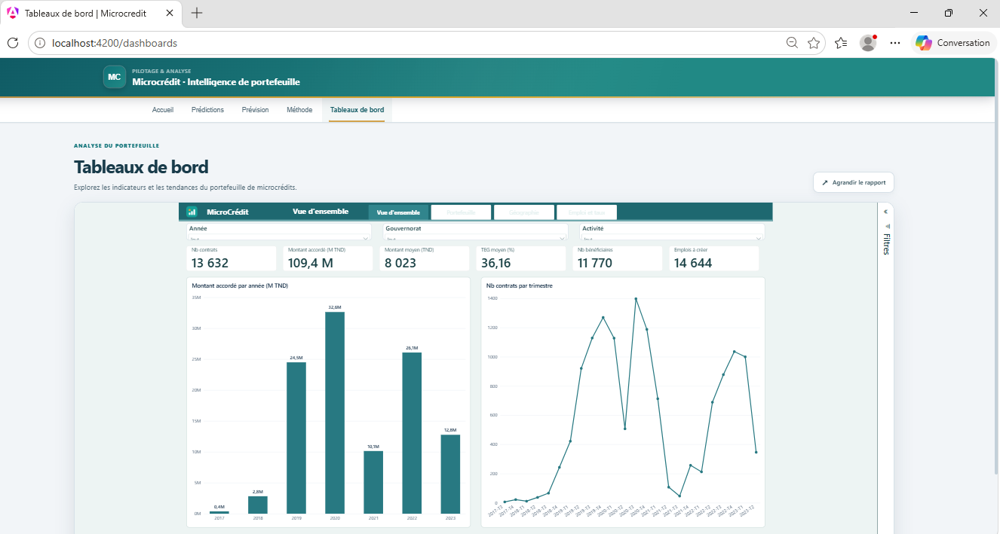

# Power BI report

The Angular dashboard embeds the Power BI Service report in an iframe. The report is hosted separately; the public repository does not contain the PBIX/PBIP source, data model, credentials, or refresh configuration. The screenshots below document the report as it appeared in the local web application on 14 October 2026. They are evidence of the visible pages, not a guarantee that the embed is publicly accessible or that the report will remain available.

## Pages documented

| Page | What it helps explore | Screenshot |
|---|---|---|
| Vue d'ensemble | Contract counts, initial amounts, average amount, mean TEG, beneficiaries, declared new jobs, and yearly trends | [Open](../screenshots/powerbi-overview.png) |
| Portefeuille | Amounts and counts by financed activity, contract duration bands, and TEG bands | [Open](../screenshots/powerbi-portfolio.png) |
| Géographie | Contract distribution and amounts by governorate, including records with missing geography | [Open](../screenshots/powerbi-geography.png) |
| Emploi et taux | Declared new/existing jobs, TEG trend, declared jobs by activity, and amount per declared new job | [Open](../screenshots/powerbi-employment-rates.png) |

## KPI definitions and interpretation

The measures below are read from the local PBIP semantic model. Names are kept close to the report labels; use the Power BI measure itself as the source of truth if the report changes.

| KPI | Calculation represented in the model | Meaning and limitation |
|---|---|---|
| Nb contrats | `COUNTROWS(fact_contract)` | Number of fact rows. Confirm the grain before treating it as unique contracts; compare with distinct `contract_id` when duplicates are possible. |
| Nb bénéficiaires | `DISTINCTCOUNT(BENEFICIAIRE_ID)` | Distinct beneficiary keys occurring in the fact table; not a count of unique people across external systems. |
| Montant accordé (TND) | `SUM(MINITIAL) / 1000` | Sum of initial amount after the report's unit conversion. Confirm the source unit with the IMF flow guide before reuse. |
| Montant moyen (TND) | Amount divided by contract count | Average historical initial amount; not a recommended or affordable amount for a new applicant. |
| TEG moyen (%) | Average `NTXTEG` | Arithmetic mean of populated source values. It is not weighted by amount and should not be interpreted as a client-specific rate. |
| TEG pondéré (%) | Amount-weighted mean `NTXTEG` | Weighted portfolio summary; does not measure profitability or repayment performance. |
| Échéance moyenne (TND) | Average `CMR / 1000` | Average recorded installment field after unit conversion; confirm units and periodicity before comparing across contracts. |
| Nb échéances moyen | Average `NECH` | Average scheduled installment count, not the number of installments actually paid. |
| Emplois à créer / existants | Sum of `NEMPNV` / `NEMPEXT` | Employment figures declared in contract records. There is no post-financing verification in this DWH, so these are not measured job outcomes. |
| Coût par emploi à créer | Amount divided by declared new jobs | Descriptive ratio only. It is not a causal impact or cost-effectiveness measure; it can be undefined when declared jobs are zero. |
| % création d'activité | Contract rows marked `CREACT = "O"` divided by all rows | Uses the source code as stored. Validate its exact business meaning and coding with the data dictionary before external interpretation. |
| Variation annuelle | Current-year amount compared with prior year | Depends on the date role and available period. Partial years should not be compared as if complete. |

### Date roles

`dim_date` is used for contract date and also has inactive relationships for disbursement, first installment, last installment, and radiation dates. The measure must activate the intended date relationship for a question. A chart by contract date is not interchangeable with one by disbursement date. The observed extract period in the notebook is 4 July 2017 to 11 May 2023; the final year is partial.

## Safe use

- Treat all displayed KPIs as descriptive summaries of the exported historical records.
- The DWH does not contain payment-event history, so the report cannot support arrears/default risk or repayment-rate KPIs.
- No verified post-financing activity or employment outcome is available; declared jobs do not prove realized impact.
- Amount-per-job and contract amounts do not measure profit, borrower affordability, or social return.
- Screenshots are aggregate views and do not intentionally show beneficiary names or document numbers. Check applicable company sharing rules before redistributing aggregate portfolio totals.
- Power BI Service access still follows the tenant/report permissions. The screenshots do not grant access to the live report.
